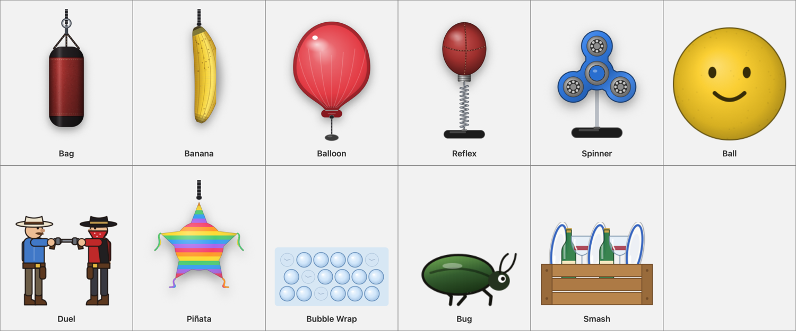

<p align="center">
  
</p>

<h1 align="center">Tantrum</h1>

<p align="center">
  <b>Throw a tantrum on your Mac, then get back to work.</b><br>
  Eleven little stress busters that live in your menu bar, and every one of them ends with a bang.
</p>

<p align="center">
  <a href="https://github.com/vibhu2807/Tantrum/releases/latest/download/Tantrum.dmg"><b>Download Tantrum for Mac</b></a>
  &nbsp;·&nbsp; free &nbsp;·&nbsp; 1.7 MB &nbsp;·&nbsp; macOS 14 or later &nbsp;·&nbsp; Apple silicon and Intel
</p>

<p align="center">
  
</p>

The build broke. The meeting ran over. The bug is back. Instead of shouting at your screen,
hit it. A punching bag hangs from the top of your screen and swings, dents and scuffs when you
punch it, with everything around it still clickable. Or pick another toy:

| | |
|---|---|
| **Bag** | A heavy leather bag. It swings, twists, dents, and after about a hundred punches the sand pours out. |
| **Banana** | Bruises, splits, then bursts. |
| **Balloon** | Pump it up, click by click, until it pops. You never know which click is the last. |
| **Reflex bag** | A speed ball on a spring that snaps back for more, until the spring gives. |
| **Spinner** | Flick it faster and faster until it glows, sparks and flies apart. |
| **Ball** | Throw it at the wall and watch it bounce back. Every ball bursts in the end. |
| **Duel** | Two cowboys you name after whoever is stressing you out. Revolvers or custard pies. |
| **Piñata** | Hit it until it bursts into confetti and sweets. |
| **Bubble Wrap** | Pop, pop, pop. Hearts, stars or pop-it squares, and an endless mode. |
| **Bug** | It runs from your cursor. Catch it and the slipper comes down. |
| **Smash** | Hurl plates, bottles and glasses at the wall, then the whole crate. |

Hit the toy from anywhere with **⌃⌥P**, switch toys with **⌃⌥⇧P**, and change everything from
the menu bar icon: colours, sizes, sound, a trackpad tap on every hit, and a quiet offer to
breathe for thirty seconds after a particularly furious minute.

## Install

1. [Download **Tantrum.dmg**](https://github.com/vibhu2807/Tantrum/releases/latest/download/Tantrum.dmg)
   and open it.
2. Drag **Tantrum** onto **Applications**.
3. Open Tantrum from Applications. Look for the little angry face in the menu bar, top right.

### The first time you open it

Tantrum is free and made by one person, so it is not registered with Apple's paid developer
program, and macOS will say it cannot verify the app the first time you open it. This happens
once. To allow it:

- **macOS 15 Sequoia and later:** open Tantrum, and when macOS says it was not opened, click
  **Done**. Open **System Settings → Privacy & Security**, scroll down to the message about
  Tantrum, click **Open Anyway**, and confirm.
- **macOS 14 Sonoma:** right-click Tantrum in Applications, choose **Open**, and click **Open**.

Prefer the terminal? This does the same thing:

```bash
xattr -dr com.apple.quarantine /Applications/Tantrum.app
```

## Hit it from your terminal

Choose **Install Command-Line Tool…** from the menu bar icon, and then:

```bash
tantrum hit              # one punch
tantrum run swift test   # run your tests; if they fail, the toy takes a beating
tantrum toy smash        # switch toys
```

To have the toy take a hit **whenever any command fails**, add this to `~/.zshrc`:

```bash
eval "$(tantrum shell-hook zsh)"
```

## Is it safe?

- **No network, no accounts, no tracking.** Tantrum never connects to the internet and collects
  nothing. Check it with any network monitor, such as Little Snitch or LuLu.
- **No special permissions.** It does not ask to record your screen, read your files or control
  your Mac.
- **Check your download.** Each release lists SHA-256 checksums. In Terminal:
  `shasum -a 256 ~/Downloads/Tantrum.dmg`, then compare with the release page.

## Uninstall

Quit Tantrum from its menu, drag it from Applications to the Bin, and if you installed the
command, delete `tantrum` from `/usr/local/bin` or `~/.local/bin`.

## Feedback and ideas

Something annoying you, or a toy you would love to see? [Open an issue](https://github.com/vibhu2807/Tantrum/issues),
or choose **Send Feedback…** from the menu. And if Tantrum made your day a little calmer, a ⭐ helps
other people find it.

## Licence

Free to use, all rights reserved. See [LICENSE](LICENSE). The source code is not published.
